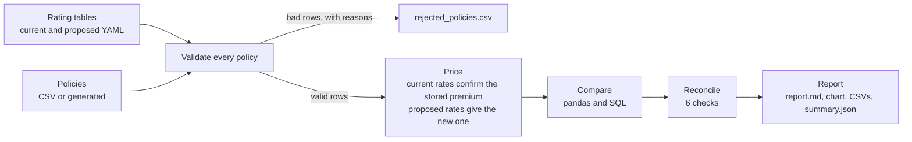
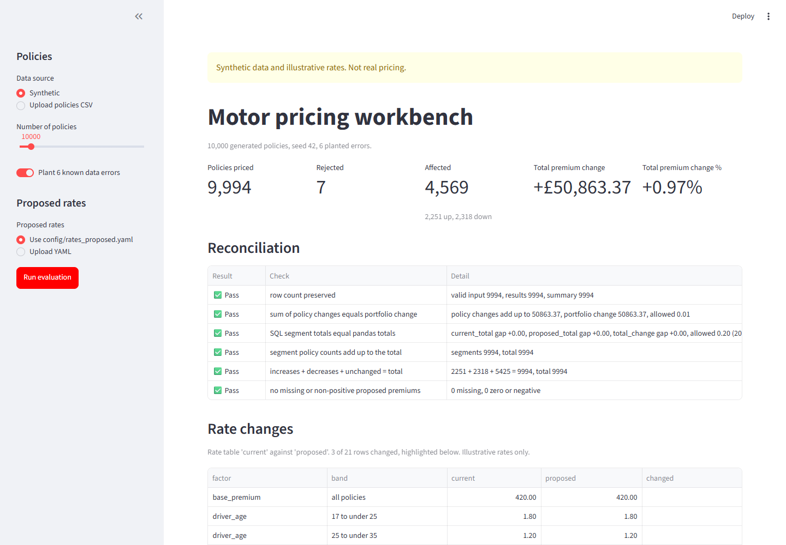
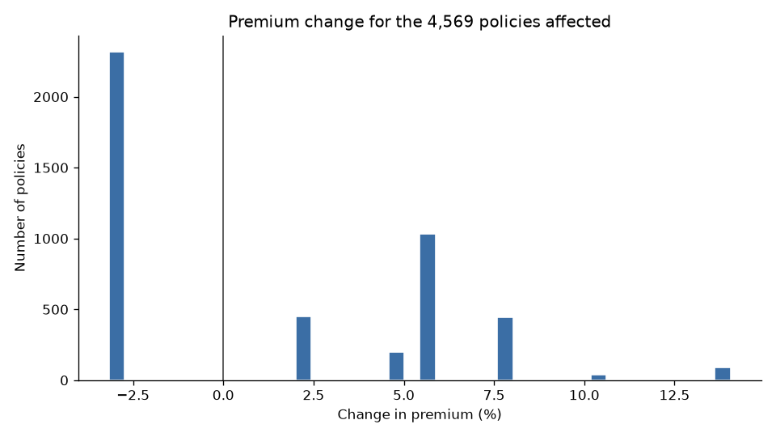

# Motor Pricing Workbench

**If we change these rating factors, what happens to every policy, and can we trust the answer?**

This project answers that question for a motor insurance portfolio. It loads two rating tables (current and proposed), checks every policy, prices each one on both sets of rates, compares the results with pandas and with SQL, makes sure all the totals agree, and writes a report.

> **All data and rates in this project are synthetic and illustrative.** The policies are randomly generated and the rating factors are made up. They are not any real insurer's pricing.


## Why I built it

Building a pricing model and building the automation that applies it are two different jobs.

Think of a restaurant. The pricing team writes the recipe: which factors matter, and by how much. The automation runs the kitchen. It takes every order, follows the recipe exactly the same way every time, notices when an ingredient is missing or off, and makes sure the bill at the end of the night matches what was served.

This project is the kitchen. The recipe (the rating tables) is a pair of YAML files that an analyst can change without touching the code. Everything else is about applying it correctly, quickly and in a way someone else can check.

| Goal | What it means here |
| --- | --- |
| **Automation** | One command runs every step, from rating tables to report, and gives the same answer every time for the same inputs. |
| **Correctness** | Bad rows are caught and kept with a reason, two pricing engines must agree to the penny, and six reconciliation checks must pass before the numbers are trusted. |
| **Performance** | Pricing is vectorised with NumPy, and the speed is measured, not guessed. |

## How it works



## The pricing formula

Every premium is the base premium multiplied by one factor for each of five rating factors:

```
premium = base premium x driver age factor x vehicle age factor
          x annual mileage factor x driving experience factor x claims factor
```

Each factor is a set of bands. For example, a driver aged 25 to 34 gets 1.20 and a driver aged 35 to 59 gets 1.00. The base premium is £420. Premiums are rounded to the nearest penny, with half pennies always rounding up.

**The proposed change.** Claims costs are rising, so the proposal charges more where the risk is highest, and gives a little back on lower risk business:

| Factor | Band | Current | Proposed |
| --- | --- | ---: | ---: |
| Annual mileage | 15,000 miles or more | 1.25 | 1.35 |
| Claims in the last 5 years | exactly 1 | 1.25 | 1.32 |
| Vehicle age | 8 to 14 years | 0.95 | 0.92 |

Everything else stays the same. The rates live in [config/rates_current.yaml](config/rates_current.yaml) and [config/rates_proposed.yaml](config/rates_proposed.yaml).

## How to run it

```bash
python -m venv .venv
.venv\Scripts\activate            # Windows
source .venv/bin/activate          # macOS or Linux
pip install -e ".[dev]"
```

| What | Command |
| --- | --- |
| Run the pipeline on 10,000 generated policies | `python -m workbench.pipeline` |
| Plant six known errors first, to see validation at work | `python -m workbench.pipeline --inject-errors` |
| Use your own policies | `python -m workbench.pipeline --input policies.csv` |
| Other options | `--policies 50000 --seed 7 --out my_run/ --max-reject-rate 0.02` |
| Run the tests | `pytest` |
| Time the engines (results go to `outputs/benchmark_results.md`) | `python benchmark.py --sizes 1000 10000 100000` |
| Time them and update the results quoted below | `python benchmark.py --sizes 1000 10000 100000 1000000 --save` |

The pipeline's exit code tells a scheduler what happened:

| Exit code | Meaning |
| ---: | --- |
| 0 | Success |
| 1 | Too many rejected rows (more than `--max-reject-rate`, 5% by default) |
| 2 | Reconciliation failed. The report is still written, marked FAILED, so you can see why |
| 3 | Bad input or config: a broken rate table, missing columns, a missing file or a bad argument |

## Run the app

There is also a small web page for running an evaluation without the command line. It is only a front end: every number comes from the same `run_evaluation` function the command line uses, so the two always agree.

```bash
pip install -e ".[dev,ui]"         # the app needs the optional ui extra (Streamlit)
streamlit run streamlit_app.py     # then open http://localhost:8501
```



What you can do on the page:

- **Choose the policies.** Generate a synthetic portfolio (1,000 to 100,000 policies, with or without the six planted errors) or upload your own policies CSV. A CSV with missing columns gets a plain message naming them.
- **Choose the proposed rates.** Use `config/rates_proposed.yaml` or upload a YAML file. An upload goes through the same rate table checks as the config files (gaps, overlaps, factors that are not positive), and nothing is priced until it passes.
- **Read the results.** Headline numbers, the six reconciliation checks, the rate changes side by side with the changed bands highlighted, the change histogram, the SQL segment table and every rejected row with its reasons.
- **Explain a policy.** The largest rise and fall in pounds are shown with their policy IDs. One click, or typing any policy ID, shows its premium factor by factor on both rate tables.
- **Download the outputs.** `policy_results.csv`, `segment_impact.csv`, `rejected_policies.csv`, `report.md` and the chart, built in memory. They match the files the command line writes.

## Output files

Everything goes to `outputs/` unless you pass `--out`.

| File | What it is for |
| --- | --- |
| `report.md` | The one page summary for a reviewer: reconciliation, rejections, impact, segments, timings |
| `summary.json` | The headline numbers and check results, for other tools to read |
| `policy_results.csv` | Every valid policy with its current and proposed premium, change and bands |
| `rejected_policies.csv` | Every rejected policy, unchanged, with the reasons it was rejected |
| `segment_impact.csv` | Impact by driver age band and mileage band, from the SQL query |
| `pct_change_distribution.png` | Histogram of the % change for the policies that change |
| `benchmark_results.md` | Timings from the last `python benchmark.py` run (written by the benchmark, not the pipeline) |

## Sample result

From [docs/sample_report.md](docs/sample_report.md), a run of `python -m workbench.pipeline --inject-errors` on 10,000 generated policies with six planted errors.

- **Input:** 10,001 rows read (one is a planted duplicate). 7 rejected (0.07%), each with its reason, and 9,994 priced.
- **Reconciliation:** all six checks passed.
- **Impact:** 4,569 of 9,994 policies change. 2,251 go up and 2,318 go down.
- **Totals:** £5,260,523.38 today, £5,311,386.75 proposed, a change of **+£50,863.37 (+0.97%)**.
- **Per policy:** the average change for an affected policy is +£11.13 (+1.23%). The largest increase is +14.05% and the largest decrease is -3.16%.
- **Where it lands:** drivers doing 15,000 miles or more see the biggest rises. Every one of those policies goes up, and drivers aged 35 to 59 in that band alone add £22,309.40.



The chart is a set of spikes rather than a smooth curve because only three factors change, so every affected policy lands on one of seven fixed changes, one for each combination of those factors (for example -3.16% for an 8 to 14 year old car alone, and +14.05% for high mileage plus one claim).

## How I know the output is right

1. **Validation.** Every policy is checked before pricing: missing values, values out of range, impossible combinations (more years driving than years since age 17), duplicate policy IDs, and stored premiums that do not match the current rates. Bad rows are never silently dropped. They go to `rejected_policies.csv` with every reason they failed.
2. **Reconciliation.** After comparing, six checks make sure the numbers add up: no rows lost, policy changes add up to the portfolio change, the SQL segment totals match the pandas totals, segment counts add up, every policy is an increase, a decrease or unchanged, and no proposed premium is missing or zero. If any check fails, the run exits with code 2.
3. **Tests.** 39 tests cover hand-worked premiums, every band edge, bad rate tables, each planted error, a regression check (pricing on the current rates must change nothing), a check that only the targeted policies move, full pipeline runs, a check that the app and the command line give the same numbers, and headless tests of the app itself. A simple row-by-row pricing engine is kept alongside the fast one, and a test requires them to agree exactly, to the penny.

## A real bug the tests caught

The fast engine and the row-by-row engine disagreed by 1p on **21 of 2,000 policies** in the test portfolio (11 of 2,000 on the proposed rates).

Both engines worked out exactly the same raw premium. The difference was in rounding. Premiums like £460.845 sit exactly on a half penny, which happens often when every factor has two decimal places. NumPy's `np.round` sends a half to the nearest even penny (£460.84), while Python's `round` depends on whether the computer happens to store the number a tiny bit above or below the half (here £460.85). Neither was following a rule anyone had chosen.

The fix was one rounding rule, `round_pence` (half pennies always round up), used by both engines. The equivalence test stays exact, with no tolerance, so if this ever comes back it fails straight away.

Why it matters: a premium has to be reproducible to the penny. If two systems cannot agree on the same policy, reconciliation fails and nobody can defend the number to a customer or an auditor.

## Measured performance

From [docs/benchmark_results.md](docs/benchmark_results.md) (Windows 11, 8 logical CPUs, Python 3.12.4). Both engines were checked to give identical premiums before timing.

| Policies | Row-by-row (s) | Vectorised (s) | Speed-up | Validation (s) |
| ---: | ---: | ---: | ---: | ---: |
| 1,000 | 0.0079 | 0.0010 | 8x | 0.0240 |
| 10,000 | 0.0790 | 0.0021 | 38x | 0.0283 |
| 100,000 | 0.9552 | 0.0165 | 58x | 0.0892 |
| 1,000,000 | 12.0158 | 0.3039 | 40x | 1.2859 |

Exact times change from run to run with whatever else the computer is doing (an earlier run was about twice as fast), but the speed-ups stay in the same range.

A normal benchmark run writes to `outputs/benchmark_results.md`, which Git ignores, so trying it out never changes the numbers above. Only a run with `--save` updates `docs/benchmark_results.md`, and the table here should be updated from that file at the same time.

What I take from it:

- **Vectorising pays off at scale and for repeated runs.** At a million policies it is 12.0 seconds against 0.30. A pricing team tests many proposals, so that gap adds up quickly.
- **At small sizes it hardly matters.** Under 10,000 policies both engines finish in less than a tenth of a second, which is why the slow engine is still worth keeping as the reference for tests.
- **Pricing is no longer the slow part.** At a million policies validation takes about 4 times as long as pricing, and in a full pipeline run at that size the slowest steps are moving data: loading rows into SQLite and writing the per-policy CSV. That is where I would look next.

## What I would change for 100 million policies

- **Partition the work,** for example by month or region, so each piece fits in memory and pieces can run in parallel.
- **Use Parquet instead of CSV** for policies and results. It is smaller, faster to read and write, and keeps column types.
- **Push the pricing into the data platform,** such as Snowflake SQL or Spark. The band lookup becomes a join between policies and a factor table, so the data never has to leave the warehouse.
- **Vectorise validation further,** and let the database enforce what it can, such as unique policy IDs.
- **Keep the same checks.** The engine comparison (on a sample), the validation reasons and the six reconciliation checks matter even more at that size, because nobody can eyeball 100 million rows.

## What I would add to make it a team tool

- **Continuous integration.** Already included: GitHub Actions runs the tests and a full pipeline run on every push and pull request.
- **Rates versioned in Git,** so every rate change goes through a pull request with a review and a clear history of who changed what.
- **A run log for audit,** recording who ran it, when, which rate files and code version were used, a fingerprint of the input file, and the outcome.
- **A small Streamlit front end.** Already included, see [Run the app](#run-the-app). Next steps would be letting an analyst pick the current rate table too, and saving each run to the audit log above.

## Honest limitations

- **Synthetic data.** The portfolio is generated, so the results show how the tool works, not what would happen to a real book of business.
- **No demand modelling.** It assumes every customer stays. In reality some customers would leave after a price rise, which changes the real revenue impact.
- **Regulatory checks are out of scope.** For example, fair value and pricing practice rules, and checks for unfair outcomes across customer groups.
- **One machine.** Everything runs in memory on a single computer. That is fine at the million policies I tested, but it would not stretch to a whole market.
- **A simple rating structure.** Five factors multiplied together, with no interactions, no claims cost model and no minimum or maximum premiums.

## Project layout

```
motor-pricing-workbench/
├── benchmark.py                 time the engines and validation (--save updates docs/)
├── streamlit_app.py             the web page: streamlit run streamlit_app.py
├── config/
│   ├── rates_current.yaml       current rating table (illustrative)
│   └── rates_proposed.yaml      proposed rating table (illustrative)
├── docs/
│   ├── benchmark_results.md     measured timings
│   ├── sample_report.md         a full report from a real run
│   ├── premium_change_distribution.png
│   └── app_screenshot.png       the web page after a run
├── sql/
│   └── impact_by_segment.sql    segment impact query
├── tests/
│   ├── conftest.py              shared test data
│   ├── test_app.py              the web page, run headless with AppTest
│   ├── test_compare.py          comparison, reconciliation, full runs
│   ├── test_evaluation.py       app and command line give the same numbers
│   ├── test_pricing.py          formula, band edges, engine agreement
│   └── test_validate.py         every planted error is caught
├── workbench/
│   ├── rates.py                 load and check rating tables
│   ├── pricing.py               vectorised and row-by-row engines
│   ├── data.py                  generate policies, plant errors
│   ├── validate.py              check every policy, keep rejects with reasons
│   ├── compare.py               compare, summarise, SQL segments, reconcile
│   ├── report.py                chart, report.md, summary.json
│   └── pipeline.py              run_evaluation, and the CLI: python -m workbench.pipeline
├── .github/workflows/tests.yml  run tests and the pipeline on every push
└── pyproject.toml
```
