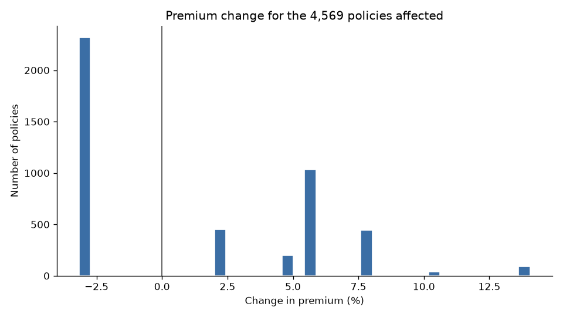

# Motor Pricing Workbench: rate change impact

Run at 2026-11-01 09:25:50

Compared rate table **current** with rate table **proposed**.

> All data and rates here are synthetic. The rates are illustrative assumptions, not real Hastings Direct pricing.

## Reconciliation: PASSED

| check | result | detail |
| --- | --- | --- |
| row count preserved | PASS | valid input 9994, results 9994, summary 9994 |
| sum of policy changes equals portfolio change | PASS | policy changes add up to 50863.37, portfolio change 50863.37, allowed 0.01 |
| SQL segment totals equal pandas totals | PASS | current_total gap +0.00, proposed_total gap +0.00, total_change gap +0.00, allowed 0.20 (20 segments) |
| segment policy counts add up to the total | PASS | segments 9994, total 9994 |
| increases + decreases + unchanged = total | PASS | 2251 + 2318 + 5425 = 9994, total 9994 |
| no missing or non-positive proposed premiums | PASS | 0 missing, 0 zero or negative |

## Input

- Policies read: 10,001
- Valid and priced: 9,994
- Rejected: 7 (0.07%). Rejected policies are kept, with reasons, in rejected_policies.csv.

Rejection reasons (a policy can have more than one):

| reason | count |
| --- | --- |
| duplicate policy_id | 2 |
| missing annual_mileage | 1 |
| driver_age out of range [17, 99] | 1 |
| annual_mileage out of range [1, 150000] | 1 |
| driving_experience exceeds driver_age - 17 | 1 |
| current_premium does not match current rating table | 1 |

## Portfolio impact

| measure | value |
| --- | --- |
| Policies affected | 4,569 of 9,994 |
| Premium goes up | 2,251 |
| Premium goes down | 2,318 |
| Current total | £5,260,523.38 |
| Proposed total | £5,311,386.75 |
| Total change | +£50,863.37 (+0.97%) |
| Average change per affected policy | +£11.13 (+1.23%) |
| Largest increase | +14.05% |
| Largest decrease | -3.16% |

## How premiums change

| change_bucket | count | share |
| --- | --- | --- |
| down >5% | 0 | 0.0% |
| down 0-5% | 2,318 | 23.2% |
| no change | 5,425 | 54.3% |
| up 0-5% | 647 | 6.5% |
| up 5-10% | 1,476 | 14.8% |
| up >10% | 128 | 1.3% |

## Impact by segment (from sql/impact_by_segment.sql)

Totals are in pounds. Sorted by total change, largest first.

| age_band | mileage_band | policies | increases | decreases | current_total | proposed_total | total_change | avg_pct_change | max_pct_change |
| --- | --- | --- | --- | --- | --- | --- | --- | --- | --- |
| 35-59 | 15k+ | 491 | 491 | 0 | 274,325.75 | 296,635.15 | +22,309.40 | +7.87% | +14.05% |
| 17-24 | 15k+ | 64 | 64 | 0 | 79,174.50 | 85,910.76 | +6,736.26 | +8.08% | +14.05% |
| 25-34 | 15k+ | 121 | 121 | 0 | 81,650.37 | 88,304.19 | +6,653.82 | +7.91% | +14.05% |
| 60-74 | 15k+ | 82 | 82 | 0 | 49,171.60 | 53,391.14 | +4,219.54 | +8.27% | +14.05% |
| 17-24 | 5k-10k | 467 | 104 | 108 | 458,418.22 | 460,667.03 | +2,248.81 | +0.22% | +5.60% |
| 35-59 | 5k-10k | 3,357 | 503 | 863 | 1,495,186.35 | 1,496,846.19 | +1,659.84 | -0.12% | +5.60% |
| 17-24 | <5k | 134 | 37 | 21 | 119,485.96 | 120,739.03 | +1,253.07 | +0.80% | +5.60% |
| 35-59 | 10k-15k | 1,469 | 235 | 392 | 720,125.67 | 721,331.90 | +1,206.23 | -0.08% | +5.60% |
| 17-24 | 10k-15k | 188 | 42 | 40 | 206,219.54 | 207,410.15 | +1,190.61 | +0.30% | +5.60% |
| 75+ | 15k+ | 12 | 12 | 0 | 9,111.38 | 9,931.99 | +820.61 | +8.64% | +14.05% |
| 60-74 | 10k-15k | 250 | 51 | 53 | 129,400.97 | 130,166.12 | +765.15 | +0.33% | +5.60% |
| 60-74 | 5k-10k | 670 | 110 | 164 | 314,240.22 | 314,924.35 | +684.13 | -0.02% | +5.60% |
| 35-59 | <5k | 853 | 130 | 214 | 341,149.87 | 341,498.48 | +348.61 | -0.11% | +5.60% |
| 25-34 | 10k-15k | 364 | 63 | 98 | 217,439.21 | 217,755.00 | +315.79 | -0.10% | +5.60% |
| 25-34 | <5k | 242 | 37 | 54 | 119,030.89 | 119,304.09 | +273.20 | -0.00% | +5.60% |
| 25-34 | 5k-10k | 911 | 127 | 233 | 490,897.89 | 491,116.29 | +218.40 | -0.17% | +5.60% |
| 60-74 | <5k | 185 | 27 | 42 | 77,634.03 | 77,769.31 | +135.28 | -0.04% | +5.60% |
| 75+ | <5k | 18 | 4 | 4 | 9,410.32 | 9,430.58 | +20.26 | -0.01% | +5.60% |
| 75+ | 10k-15k | 31 | 2 | 8 | 19,324.30 | 19,255.22 | -69.08 | -0.45% | +5.60% |
| 75+ | 5k-10k | 85 | 9 | 24 | 49,126.34 | 48,999.78 | -126.56 | -0.42% | +5.60% |

## Run timings

| step | seconds |
| --- | --- |
| load rates | 0.025 |
| load data | 0.060 |
| validate | 0.030 |
| write rejected | 0.005 |
| price and compare | 0.009 |
| summarise | 0.004 |
| distribution | 0.002 |
| SQL segments | 0.050 |
| reconcile | 0.004 |
| write outputs | 0.216 |

Total: 0.405 seconds (before writing this report).
